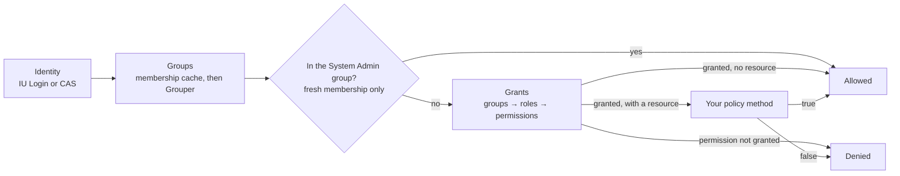

# Authorization

> For app developers who want to know how the framework decides whether a user may do something.

The framework answers "may this user do this?" from four things: who the user is, their Grouper groups,
the grants an administrator set up, and, for one resource, your policy.

Diagram as text

1. The framework reads who the user is, from IU Login or from CAS.
2. It gets the user's Grouper groups, from the membership cache if it's recent enough, otherwise from Grouper.
3. If the user is in the System Admin group, the check is allowed. This step uses only fresh membership.
4. Otherwise the framework maps the user's groups to roles, and the roles to permissions. If no role grants the permission, the check is denied.
5. If the check names no resource, a granted permission is enough.
6. If it names a resource, your policy method for that resource and permission decides.

A guest has no groups and no grants. A guest passes a check only when it names a resource and the
policy method takes `?User` and returns `true`.

## Grants

An administrator registers Grouper groups and maps each to roles, and gives each role permissions, at
`/framework/authorization`. Permissions are the cases of your app's permission enum; the stored grant is
the case's value. Grants live in your app's database and are read fresh on every request, so a change
takes effect on the user's next request. A grant whose value is no longer a case of your enum grants
nothing.

## Membership cache

Grouper lookups are slow, so the framework keeps each user's groups in their PHP session.

| Membership age | What the framework does |
|---|---|
| Younger than `membershipTtl` | Uses the cached groups without asking Grouper |
| Older, and Grouper answers | Asks Grouper and replaces the cache |
| Older, Grouper unreachable, younger than `membershipTtl` + `staleCap` | Uses the cached groups and logs a warning |
| Past that, or nothing cached | Throws `AuthorizationUnavailableException`, which becomes a 503 |

The System Admin check never uses stale membership, because it bypasses every other check. While
membership is stale, a System Admin is treated like any other user and gets only their roles' grants.

## Why a Grouper outage gives a 503

When the framework can't learn a user's groups, it has no answer to give. A 403 would tell the user
they lack access, which may be wrong, and allowing the request would let anyone through. A 503 reports
a temporary failure instead, and the stale window keeps most users working through a short outage.

Rejected Grouper credentials are different: they won't fix themselves, so they throw instead of
becoming a 503. [guild/grouper's outcomes](https://github.com/nathanskky/guild-grouper/blob/main/docs/concepts/outcomes.md)
lists which Grouper answers are thrown.

## Policies

A policy decides which instances of a resource a user holding a permission may act on. Each policy names
one resource class and has one method per permission, and the class must match the resource exactly. The framework
reads policies the first time a check uses one, and a mistake in a policy throws `ConfigurationException`
for every user, not only for those with the grant.

## Related

- [Set up authorization](../guides/set-up-authorization.md) turns this on in your app.
- [Check permissions](../guides/check-permissions.md) and [Write a policy](../guides/write-a-policy.md) use it.
- [Failure responses](../reference/failure-responses.md) lists what a denied or unavailable check shows.
- [Glossary](../reference/glossary.md) defines grant, role, policy and the other terms on this page.
