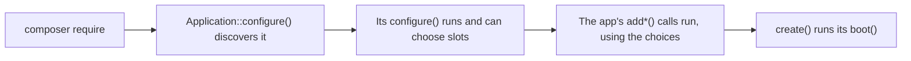

# Extensions

> For app developers and package authors who want to know how an installed package changes a Guild app.

An extension is a Composer package that changes how a Guild app works without code in the app. The
framework defines extensions; to Composer, an extension is an ordinary package whose `type` is
`guild-extension`. guild/dev-tools, which adds persona sign-in, is one.

Diagram as text

1. You install the package with Composer.
2. `Application::configure()` discovers it among the installed packages.
3. The extension's `configure()` runs before any of the app's own calls, and can choose slots.
4. The app's `add*()` calls run and use what the extension chose.
5. `create()` runs the extension's `boot()`, with the container ready.

Discovery reads Composer's list of installed packages, finds each package of type `guild-extension`, and
builds the class it names in `extra.guild.extension`. Extensions run in package name order.

## Slots

A slot is one part of the app that an extension can choose for it. Choosing a slot replaces what the
app's config file would have supplied.

| Slot | Builder method | Replaces |
|---|---|---|
| Sign-in method | `useSignInMethod()` | IU Login and `config/authentication.php` |
| Group directory | `useGroupDirectory()` | Grouper and `config/grouper.php` |
| System Admin group | `useSystemAdminGroup()` | `systemAdminGroup` in `config/authorization.php` |

Each slot can be chosen once. Two extensions choosing the same slot stop the app at startup with a
message naming both. The app still makes the `add*()` call that reads the slot: an extension that
chooses the sign-in method still needs the app to call `addAuthentication()`.

`create()` logs each choice at `notice`, so the log shows which extension replaced what. A choice that
nothing reads, such as a group directory in an app without `addAuthorization()`, is logged and ignored.

With a chosen group directory there's no Grouper connection, so registering a group at
`/framework/authorization`, which looks the name up in Grouper, answers 503. Editing, mapping and
unregistering groups still work.

## Development-only extensions

An extension installed with `require-dev` never runs in a production build. After
`composer install --no-dev`, or `composer dump-autoload --no-dev` over a development install, discovery
skips it.

## Related

- [Write an extension](../guides/write-an-extension.md) shows how to build one.
- [How a request is handled](how-a-request-is-handled.md) shows where extensions run during startup.
