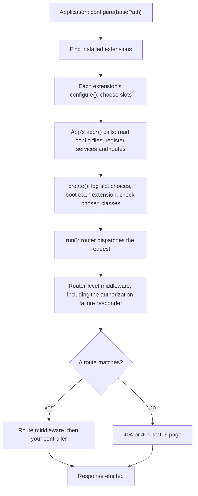

# How a request is handled

> For app developers who want to know how a Guild app starts, what each `add*()` call wires in, and how
> a request becomes a response.

A Guild app builds one container per request. `bootstrap/app.php`, or your own entry point, calls
`Application::configure()`, chains the `add*()` calls the app needs, and calls `create()` and `run()`.

Diagram as text

1. `Application::configure($basePath)` finds the installed extensions.
2. Each extension's `configure()` runs and can choose a slot, such as the sign-in method.
3. The app's own `add*()` calls run. Each one reads its config file, if it has one, and registers its services and routes in the container.
4. `create()` logs each slot an extension chose, boots each extension, and checks the container can build every chosen class.
5. `run()` hands the request to the router.
6. The router runs router-level middleware first, including the authorization failure responder that `addAuthorization()` adds.
7. If a route matches, its middleware runs and then your controller. If none matches, the app answers with a 404 or 405 status page.
8. The response is emitted.

## The add calls

Every `add*()` call is optional, and each reads only its own config file. An app needs only the files
for what it enables; [Config files](../reference/config-files.md) lists which call reads which file.
Some calls depend on others: `addRivet()` comes after `addTemplateEngine()`, and with IU Login,
`addAuthorization()` comes after `addAuthentication()`. A call in the wrong order throws
`ConfigurationException` at startup, with a message naming the fix.

The services a call registers are built only when something asks for them, so a request that never
checks a permission never contacts Grouper. `ApplicationBuilder`'s docblocks describe each call.

## Routes and controllers

`addRouting()` loads your `routes/routes.php`, which returns a function that receives the `Router`, a
[league/route](https://route.thephpleague.com/6.x/) router. The container builds your controllers, so
they can ask for `View`, `Gate` or any other service in their constructors.

The framework mounts its own pages under `/framework`, so don't use that path for your own routes.

## Responses the framework writes

A request no route answers gets a 404 status page, or a 405 with an `Allow` header for a path that
doesn't take the request's method. An authorization failure gets a 403, a sign-in challenge or a 503.
[Failure responses](../reference/failure-responses.md) lists them all. With `addRivet()`, these pages use
your app's `rvt_page` layout; without it, they're plain HTML.

Router-level middleware wraps the status pages, as it wraps your pages. Middleware added at router level
runs first-added-outermost. Your own router-level exception middleware therefore sees authorization
exceptions only when `addRouting()` comes after `addAuthorization()`.

## Logging

The framework logs to a Monolog logger on the `framework` channel that writes through PHP's
`error_log()`. In the `php:*-apache` image that reaches the container's standard error. To log
elsewhere, pass your own PSR-3 logger to `withLogger()`.

## Related

- [Extensions](extensions.md) explains how an installed package changes the app before your calls run.
- [Authorization](authorization.md) explains how a permission check is decided.
- [Config files](../reference/config-files.md) lists each call's file and what it returns.
